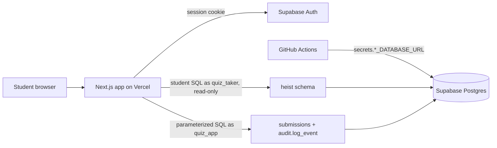
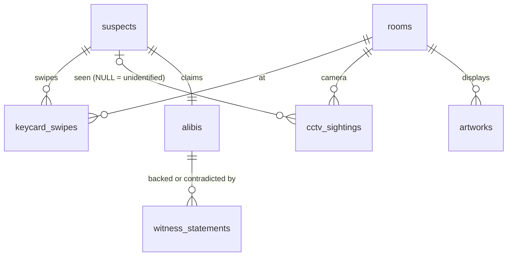

# The Midnight Heist: a SQL Detective Quiz

[](https://github.com/alissarivero/mindnight-heist-sql-quiz/actions/workflows/ci.yml)

**Live quiz site: <https://mindnight-heist-sql-quiz-cwwb.vercel.app>**

On the night of 13–14 March 2026, *The Azure Heron* ($18.5M) vanished from Gallery B of the Hollowell Museum at **00:47**. Every keycard swipe, camera hit, and alibi is stored in a hosted Postgres database. You sign in as a detective, write SQL against the live evidence, solve five clues worth **20 points**, and name the thief.

This repo is a complete small system: a **hosted PostgreSQL database** (Supabase), **authentication** (Supabase Auth), **GitHub Actions using GitHub Secrets**, and a **20-point SQL quiz** that runs against live data. It also implements all three extra-credit items.

---

## Contents

1. [How the requirements are met](#how-the-requirements-are-met)
2. [Architecture](#architecture)
3. [How to take the quiz](#how-to-take-the-quiz)
4. [The quiz: questions, points, hints](#the-quiz)
5. [Database design](#database-design)
6. [Security model](#security-model)
7. [Audit log and integrity check (extra credit)](#audit-log-and-integrity-check-extra-credit)
8. [Setup from scratch](#setup-from-scratch)
9. [GitHub Actions](#github-actions)
10. [Project layout](#project-layout)
11. [Troubleshooting](#troubleshooting)

---

## How the requirements are met

| Requirement | Where |
| --- | --- |
| Hosted PostgreSQL | Supabase Postgres, reached over the network through the **Session pooler** with `sslmode=require` ([`lib/pgConfig.ts`](lib/pgConfig.ts)) |
| Authentication | Supabase Auth (email + password, or magic link). Every data API route calls [`withUser`](lib/api.ts) and returns **401** for signed-out users, so they can neither run nor save a query |
| GitHub Actions + Secrets | [`.github/workflows/ci.yml`](.github/workflows/ci.yml) reads `DATABASE_URL`, `APP_DATABASE_URL`, and `TAKER_DATABASE_URL` from `secrets.*` and runs live checks against Supabase. No password appears in any workflow file |
| 20-point SQL quiz | 5 questions × 4 points ([`lib/questions.ts`](lib/questions.ts)). Each has a hint with the expected SQL and the expected result ([`lib/answers.ts`](lib/answers.ts)) |
| Run SQL and see the result table | `/case/<n>` has a Monaco SQL editor. **Run** executes against the live database and shows the rows |
| Extra: parameterized queries | All SQL the app writes itself uses `$1, $2, …` placeholders ([`lib/db.ts`](lib/db.ts)). Student SQL is not string-built into anything; it runs alone in a sandboxed role (see [Security model](#security-model)) |
| Extra: audit log | `audit.log` records every **run, save, explain, and hint** with user, SQL, row count, correctness, and timestamp. It can be viewed at `/case-log` |
| Extra: integrity check | The log is **hash-chained** (SHA-256), **append-only** (triggers block UPDATE, DELETE, and TRUNCATE, even for the owner), and the taker role has **no access** to it. `audit.verify_chain()` proves it is untampered, and CI runs it |

`.env` / `.env.local` are in [`.gitignore`](.gitignore). Only [`.env.example`](.env.example), which has placeholders and no secrets, is committed.

---

## Architecture



- **Frontend and server**: Next.js 15 (App Router, TypeScript), Tailwind CSS v4, Motion, and the Monaco editor (the editor VS Code uses).
- **Auth**: `@supabase/ssr` keeps the session in cookies. The middleware refreshes the session, and every API route re-verifies the user with Supabase (`auth.getUser()`).
- **Database access**: `pg` (node-postgres) and `pg-cursor`, through **two separate connection pools that use two different database logins**:
  - `quiz_taker` executes the student's SQL. It is read-only.
  - `quiz_app` writes submissions and audit entries, using parameterized SQL only.

**What happens when you click Run:**

```mermaid
sequenceDiagram
  participant B as Browser
  participant A as "/api/run"
  participant T as "Postgres (quiz_taker)"
  participant L as "Postgres (quiz_app)"
  B->>A: POST sql, questionId (with session cookie)
  A->>A: verify user with Supabase Auth (else 401)
  A->>A: single-statement guard
  A->>T: BEGIN READ ONLY; SET LOCAL statement_timeout=5s
  A->>T: cursor (extended protocol), read at most 501 rows
  A->>T: ROLLBACK
  A->>L: SELECT audit.log_event($1..$7)
  A-->>B: columns, types, rows, ms
```

**Submit answer** does the same, then grades the result set on the server and inserts a row into `public.submissions` with a parameterized query.

---

## How to take the quiz

1. Open the live site and click **Sign in**. Choose **New detective? Sign up**, enter an email and password, and sign in. You can also use a **Magic link**.
2. Open the **Evidence Board** (`/case`) and click a case file (Exhibit A–E).
3. Read the brief. The **schema explorer** on the left lists every table and column live from the database. Click a name to insert it into the editor. Autocomplete also knows the schema.
4. Write SQL in the editor and press **Run** (or `⌘/Ctrl + Enter`). The result table shows rows, column types, the row count, and the execution time. You can export it as CSV.
5. When you are happy with the result, press **Submit answer** (`⌘/Ctrl + S`). The server re-runs your query and compares the **result set** to the answer key, ignoring row order and column names:
   - **MATCH**: you get the clue's points, the case file is stamped *Solved*, and red string connects it on the board.
   - **NO MATCH**: your answer is still saved. You see how many rows are missing and which of your rows shouldn't be there.
6. Stuck? Open the **Hint** tab and click **Request evidence from HQ**. Hint 1 is the expected SQL, and Hint 2 is the expected result table. Requesting a hint is recorded in the audit log.
7. Other tabs:
   - **Query plan** (`Explain` button) renders `EXPLAIN (FORMAT JSON)` as a visual plan tree.
   - **History** lets you restore any previous run of the current clue.
8. Solve all five clues to unlock **The Accusation** (`/case/accuse`).
9. **Case Log** (`/case-log`) shows the full audit trail and a live *Chain intact* badge.

Signed out, you can read the briefing and case files and draft SQL. The Run and Submit buttons are disabled, and the API rejects any direct request with HTTP 401.

---

## The quiz

Five questions at 4 points each, 20 points total. All tables live in schema `heist`. The quiz role's `search_path` is `heist`, so `suspects` and `heist.suspects` both work. Grading compares **result sets**: the number of columns must match, and rows are compared as a multiset. Row order, column aliases, and number formatting (`21` vs `21.000`) are ignored.

<details>
<summary><strong>Answer key: expected SQL and expected result for every question</strong> (this is the same content as the in-app hints)</summary>

### Q1 · Who Was Inside? (4 pts): JOIN, range filter, DISTINCT

> List the `name` of every suspect who swiped **in** at any door between `2026-03-13 22:00` and `2026-03-14 02:00` (inclusive). Each name once, alphabetical.

```sql
SELECT DISTINCT s.name
FROM suspects s
JOIN keycard_swipes k ON k.suspect_id = s.id
WHERE k.direction = 'in'
  AND k.swiped_at BETWEEN '2026-03-13 22:00' AND '2026-03-14 02:00'
ORDER BY s.name;
```

| name |
| --- |
| Darius Okafor |
| Elena Voss |
| Margot Chen |
| Nadia Bloom |
| Oliver Grant |
| Priya Nair |
| Tomas Rivera |
| Victor Langley |

### Q2 · The Busy Doors (4 pts): GROUP BY, HAVING

> For swipes from `2026-03-14 00:00` up to (not including) `02:00`, count swipes per room. Return room name and count for rooms with **more than 3** swipes, busiest first.

```sql
SELECT r.name, COUNT(*) AS swipes
FROM keycard_swipes k
JOIN rooms r ON r.id = k.room_id
WHERE k.swiped_at >= '2026-03-14 00:00'
  AND k.swiped_at <  '2026-03-14 02:00'
GROUP BY r.name
HAVING COUNT(*) > 3
ORDER BY swipes DESC, r.name;
```

| name | swipes |
| --- | --- |
| Loading Dock | 7 |
| Gallery B | 6 |
| Staff Lounge | 4 |
| Vault Corridor | 4 |

### Q3 · Shaky Alibis (4 pts): anti-join / NOT EXISTS

> List each suspect whose alibi has **no** witness statement with `corroborates = true`, with their `claimed_location`. (Trap: some alibis have a statement that *contradicts* them.)

```sql
SELECT s.name, a.claimed_location
FROM suspects s
JOIN alibis a ON a.suspect_id = s.id
WHERE NOT EXISTS (
  SELECT 1
  FROM witness_statements w
  WHERE w.alibi_id = a.id
    AND w.corroborates
)
ORDER BY s.name;
```

| name | claimed_location |
| --- | --- |
| Darius Okafor | Restoration Lab, working late |
| Elena Voss | Hotel Marlowe bar |
| Oliver Grant | On a delivery route across town |
| Priya Nair | Security Office, patching servers |

### Q4 · Caught on Camera (4 pts): interval arithmetic, INNER vs LEFT JOIN

> Every **identified** suspect seen by the **Gallery B** camera within 10 minutes either side of `2026-03-14 00:47`, as name, seen_at, and confidence, earliest first. (Trap: an *unidentified* figure with `suspect_id IS NULL` is in the window.)

```sql
SELECT s.name, c.seen_at, c.confidence
FROM cctv_sightings c
JOIN suspects s ON s.id = c.suspect_id
JOIN rooms r    ON r.id = c.camera_room_id
WHERE r.name = 'Gallery B'
  AND c.seen_at BETWEEN TIMESTAMP '2026-03-14 00:47' - INTERVAL '10 minutes'
                    AND TIMESTAMP '2026-03-14 00:47' + INTERVAL '10 minutes'
ORDER BY c.seen_at;
```

| name | seen_at | confidence |
| --- | --- | --- |
| Darius Okafor | 2026-03-14 00:41:00 | 0.88 |
| Priya Nair | 2026-03-14 00:52:00 | 0.61 |

### Q5 · The Accusation (4 pts): CTE, window function (LEAD), EXTRACT(EPOCH)

> Pair each `'in'` swipe at the **Vault Corridor** with that suspect's next swipe there (`LEAD`), sum the minutes per suspect, and return only the top suspect: name and integer minutes.

```sql
WITH vault AS (
  SELECT k.suspect_id,
         k.direction,
         k.swiped_at,
         LEAD(k.swiped_at) OVER (
           PARTITION BY k.suspect_id ORDER BY k.swiped_at
         ) AS next_swipe
  FROM keycard_swipes k
  JOIN rooms r ON r.id = k.room_id
  WHERE r.name = 'Vault Corridor'
)
SELECT s.name,
       SUM(EXTRACT(EPOCH FROM (v.next_swipe - v.swiped_at)) / 60)::int AS minutes_in_vault
FROM vault v
JOIN suspects s ON s.id = v.suspect_id
WHERE v.direction = 'in'
GROUP BY s.name
ORDER BY minutes_in_vault DESC
LIMIT 1;
```

| name | minutes_in_vault |
| --- | --- |
| Darius Okafor | 21 |

</details>

These expected results are verified automatically in two ways:
- **Offline**: [`tests/unit/answers.test.ts`](tests/unit/answers.test.ts) loads the seed SQL into an in-process Postgres (PGlite) and runs every hint.
- **Against the live Supabase database**: [`tests/live/live.test.ts`](tests/live/live.test.ts) runs every hint in CI.

Because of these checks, a hint can never drift from the data. `npm run db:answers` prints them from the live database.

---

## Database design



| Table | Rows | Purpose |
| --- | --- | --- |
| `heist.suspects` | 10 | name, role, motive |
| `heist.rooms` | 8 | museum rooms with floor and security level |
| `heist.keycard_swipes` | 53 | every badge swipe (`direction` in/out, `swiped_at` timestamp) |
| `heist.cctv_sightings` | 13 | face-match hits with `confidence` (one unidentified) |
| `heist.alibis` | 10 | each suspect's claimed location and time window |
| `heist.witness_statements` | 9 | statements that corroborate (`true`) or contradict (`false`) an alibi |
| `heist.artworks` | 7 | collection (the Heron is `missing`) |
| `public.submissions` | n/a | saved answers: user, question, SQL, correct?, row count |
| `audit.log` | n/a | hash-chained audit trail |

The SQL lives in [`sql/`](sql):
- [`01_schema.sql`](sql/01_schema.sql) defines the tables.
- [`02_seed.sql`](sql/02_seed.sql) holds the story data.
- [`03_app.sql`](sql/03_app.sql) sets up submissions and the audit log.
- [`04_grants.sql`](sql/04_grants.sql) sets up roles and privileges.

---

## Security model

Student SQL is arbitrary text, so it cannot be bound as a parameter. Instead it is **contained** by several layers:

1. **Separate least-privilege login.** Student SQL only ever runs on a pool that logs in as `quiz_taker`. This role:
   - has `SELECT` on `heist.*` and nothing else, so it cannot read `public.submissions` or `audit.*`;
   - defaults to `default_transaction_read_only = on`;
   - has `statement_timeout = 5s`.

   A separate login is used, rather than `SET ROLE` on a shared connection, because a student could undo `SET ROLE` with `RESET ROLE`.
2. **Read-only, always rolled back.** Every query runs inside `BEGIN READ ONLY … ROLLBACK`.
3. **One statement only.**
   - [`lib/sqlGuard.ts`](lib/sqlGuard.ts) rejects semicolon-stacked statements. Semicolons inside strings, identifiers, and comments are ignored.
   - The query is also sent through `pg-cursor`, which uses the **extended query protocol**, so Postgres itself refuses multi-statement input. `SELECT 1; DROP TABLE …` cannot run.
4. **Bounded output.** The cursor reads at most 501 rows, and the UI shows 500 with a "capped" flag. Input is limited to 5,000 characters.
5. **Everything else is parameterized.** Saving submissions, writing audit events, and reading progress or history all go through `quiz_app` with `$n` placeholders ([`lib/db.ts`](lib/db.ts)).
6. **Answer keys stay on the server.** Expected rows are never sent to the browser on a wrong submission (only a count of missing rows). Hints are served only to signed-in users through `/api/hint`, which logs the request.

The live tests prove these properties against Supabase. For example, they check that `quiz_taker` cannot INSERT, cannot read or modify `audit.log`, and cannot forge an audit event, and that stacked statements are rejected.

---

## Audit log and integrity check (extra credit)

- **What is logged**: every `run`, `save` (with correctness), `explain`, and `hint`, along with the user id and email, question, SQL text, row count, and timestamp.
- **How it is written**: only through `audit.log_event(...)`, a `SECURITY DEFINER` function. `quiz_app` may `EXECUTE` it but has **no INSERT/UPDATE/DELETE privilege** on the table. `quiz_taker` has no access to the `audit` schema at all.
- **Append-only**: `BEFORE UPDATE OR DELETE` and `BEFORE TRUNCATE` triggers raise `audit.log is append-only`. This applies even to the table owner.
- **Tamper-evident hash chain**:
  - Each entry stores `prev_hash` and `row_hash = sha256(prev_hash ‖ user ‖ action ‖ question ‖ sql ‖ rows ‖ correct ‖ timestamp)`.
  - Writers are serialized with a table lock, so the chain is linear.
  - If anyone with superuser access disables the triggers and edits a row, every hash from that row onward stops matching.
- **Verification**: `SELECT * FROM audit.verify_chain();` recomputes the whole chain and returns `ok`, `total_rows`, and `first_bad_id`. It runs in CI and powers the green/red badge on `/case-log`. [`tests/unit/audit.test.ts`](tests/unit/audit.test.ts) demonstrates that tampering is detected.

---

## Setup from scratch

Prerequisites: Node.js 20+ (22 recommended), a free [Supabase](https://supabase.com) account, a GitHub account, and a free [Vercel](https://vercel.com) account.

### 1. Clone and install

```bash
git clone https://github.com/alissarivero/mindnight-heist-sql-quiz.git
cd mindnight-heist-sql-quiz
npm install
```

### 2. Create the Supabase project

1. In Supabase, click **New project** and save the database password.
2. Go to **Connect**, then **Session pooler**. Copy the URI. It looks like
   `postgresql://postgres.<ref>:<password>@aws-0-<region>.pooler.supabase.com:5432/postgres`.
   Use the **Session pooler**, not the Direct connection, and append `?sslmode=require`.
3. Go to **Project Settings**, then **API**. Copy the **Project URL** and the **anon / publishable key**.
4. Go to **Authentication**, then **Sign In / Providers**, then **Email**. For a classroom demo, consider turning **Confirm email** off so classmates can sign up and start immediately. Under **URL Configuration**, add your site URL (and `http://localhost:3000`) so magic links redirect correctly.

### 3. Configure local environment

```bash
cp .env.example .env.local    # .env.local is git-ignored
```

Fill in `.env.local`:

| Variable | Value |
| --- | --- |
| `NEXT_PUBLIC_SUPABASE_URL` | Project URL |
| `NEXT_PUBLIC_SUPABASE_ANON_KEY` | anon / publishable key |
| `DATABASE_URL` | Session pooler URI for `postgres.<ref>` with `?sslmode=require` |
| `QUIZ_APP_PASSWORD` | a new strong password you choose for role `quiz_app` |
| `QUIZ_TAKER_PASSWORD` | a new strong password you choose for role `quiz_taker` |
| `APP_DATABASE_URL` | the same pooler URI with user `quiz_app.<ref>` and `QUIZ_APP_PASSWORD` |
| `TAKER_DATABASE_URL` | the same pooler URI with user `quiz_taker.<ref>` and `QUIZ_TAKER_PASSWORD` |

### 4. Build the database

```bash
npm run db:setup      # schema + seed + audit log + roles + grants (safe to re-run)
npm run db:answers    # prints each hint's live result and confirms it matches
npm run test:live     # optional: the same live checks CI runs
```

### 5. Run locally

```bash
npm run dev           # http://localhost:3000
```

### 6. Deploy to Vercel

1. Push the repo to GitHub.
2. In Vercel, click **Add New**, then **Project**, and import the repo. The framework is detected as Next.js.
3. Under **Environment Variables**, add `NEXT_PUBLIC_SUPABASE_URL`, `NEXT_PUBLIC_SUPABASE_ANON_KEY`, `APP_DATABASE_URL`, and `TAKER_DATABASE_URL`. The app itself never needs the admin `DATABASE_URL`.
4. Deploy. Then put the URL at the top of this README and in Supabase's **Auth URL Configuration**.

### 7. Add GitHub Secrets

In the GitHub repo, go to **Settings**, then **Secrets and variables**, then **Actions**, and click **New repository secret** for each of:

| Secret | Used by |
| --- | --- |
| `DATABASE_URL` | CI live tests, DB setup workflow |
| `APP_DATABASE_URL` | CI live tests |
| `TAKER_DATABASE_URL` | CI live tests |
| `NEXT_PUBLIC_SUPABASE_URL` | CI build |
| `NEXT_PUBLIC_SUPABASE_ANON_KEY` | CI build |
| `QUIZ_APP_PASSWORD`, `QUIZ_TAKER_PASSWORD` | DB setup workflow only |

Then open **Actions**, select **CI**, and click **Run workflow**, or push a commit. Both jobs should turn green.

---

## GitHub Actions

[`.github/workflows/ci.yml`](.github/workflows/ci.yml) runs on every push to `main`, on pull requests, and on manual dispatch.

| Job | What it does |
| --- | --- |
| `build` | `npm ci`, ESLint, TypeScript typecheck, unit tests (answer key + audit log in in-process Postgres), `next build` |
| `live-db` | Reads `DATABASE_URL`, `APP_DATABASE_URL`, and `TAKER_DATABASE_URL` from **GitHub Secrets**, confirms they are set, connects to Supabase over TLS, and checks that every hint returns its expected rows. It also verifies that `quiz_taker` is read-only and locked out of the audit log, that `quiz_app` cannot rewrite history, that stacked statements are rejected, and that `audit.verify_chain()` is intact. It then prints the live answer key |

[`.github/workflows/db-setup.yml`](.github/workflows/db-setup.yml) is a manual workflow that rebuilds the case data and re-applies grants from GitHub, also using secrets only.

GitHub masks secret values in logs. The workflows contain only `${{ secrets.NAME }}` references and no passwords.

---

## Project layout

```text
app/
  page.tsx                 landing page (live suspect lineup from Postgres)
  login/                   Supabase sign in / sign up / magic link
  case/page.tsx            evidence board (progress, score ring, red string)
  case/[id]/page.tsx       question workspace
  case/accuse/page.tsx     final reveal (unlocks at 20/20)
  case-log/page.tsx        audit trail + chain verification badge
  api/run|save|explain|hint|schema|history/route.ts
  auth/callback/route.ts   magic-link / email-confirm handler
components/
  EvidenceBoard, Accusation, LoginForm, Stamp, ScoreRing, Typewriter, NavBar
  workspace/  Workspace, SqlEditor (Monaco), SchemaExplorer, ResultGrid,
              PlanTree, HintVault, HistoryList, Verdict
lib/
  db.ts         pools, sandboxed student-SQL runner, parameterized app queries
  pgConfig.ts   session-pooler TLS config (sslmode=require)
  sqlGuard.ts   single-statement guard
  grading.ts    result-set comparison
  questions.ts  public question text   answers.ts  server-only answer key
  supabase/     server + browser auth clients
sql/            01_schema, 02_seed, 03_app (submissions + audit), 04_grants
scripts/        setup-db.ts, print-answers.ts
tests/unit/     grading, sql guard, answer key + audit log on PGlite
tests/live/     checks against the real Supabase DB (used by CI)
middleware.ts   refreshes the Supabase session cookie
```

Useful commands: `npm run dev`, `npm run build`, `npm run lint`, `npm run typecheck`, `npm test`, `npm run test:live`, `npm run db:setup`, `npm run db:answers`.

---

## Troubleshooting

- **`password authentication failed for user "quiz_taker"`**: the pooler username must include the project ref: `quiz_taker.<ref>`. Re-run `npm run db:setup` after changing `QUIZ_TAKER_PASSWORD`.
- **`self-signed certificate in certificate chain`**: use the connection string exactly as described, with `?sslmode=require`. [`lib/pgConfig.ts`](lib/pgConfig.ts) applies libpq `require` semantics (TLS on, certificate not pinned).
- **Sign-up says "check your inbox" and nothing arrives**: Supabase's built-in mailer is rate-limited. Disable **Confirm email** for the class, or configure SMTP.
- **Magic link opens the wrong site**: add the deployed URL under **Authentication**, then **URL Configuration**.
- **CI `live-db` fails with "Missing GitHub Secrets"**: add the secrets listed in [step 7](#7-add-github-secrets).
